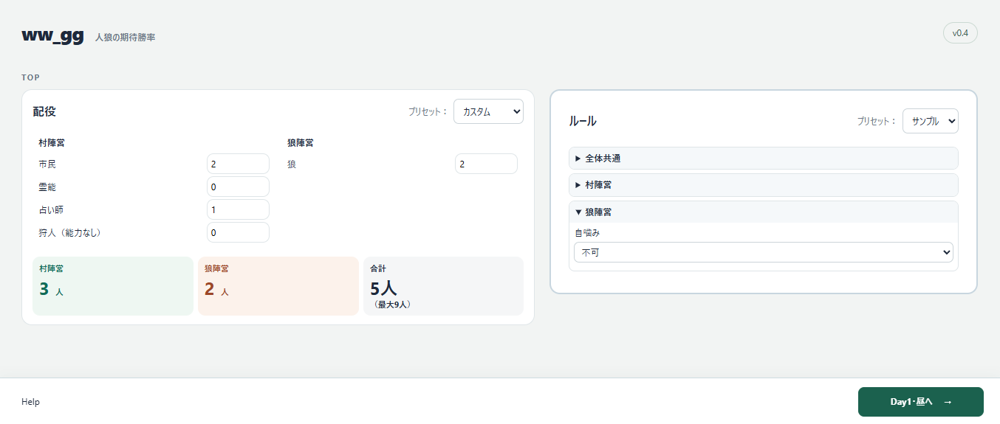
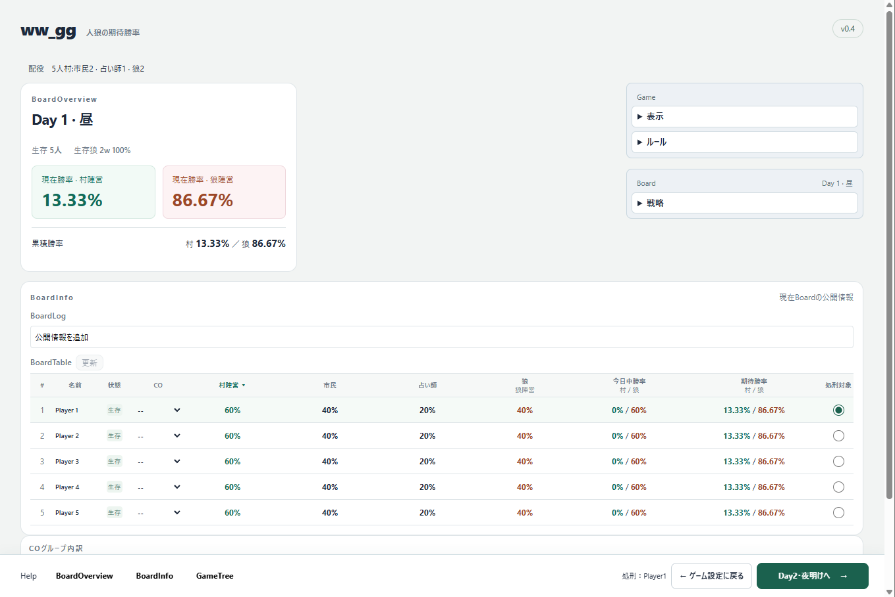
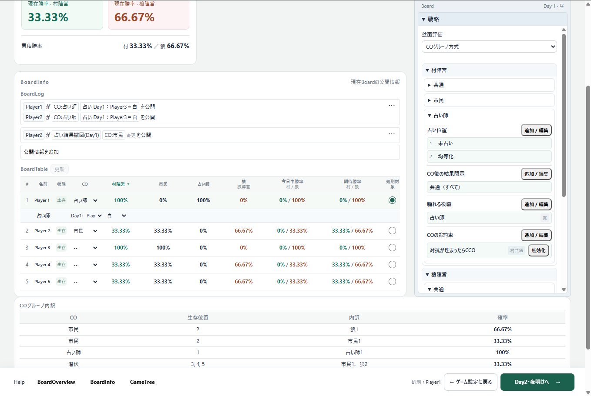
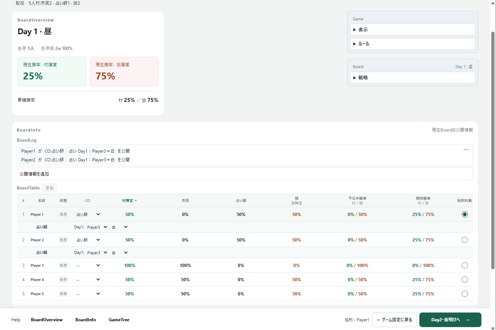

# ww_gg

人狼ゲームの公開情報・共有戦略・想定戦略から、各盤面での期待勝率を算出します。

計算には、確率モデルに基づく厳密計算を使用します。

（計算に使用しないもの：乱数を使ったシミュレーション、対戦データに基づく統計的推定、発言・心理の分析など）

## 開発体制

AI実装です。開発者は主に要件定義・動作確認・受け入れテストを担当しています。

## デモ

[公開URL](https://ww-gg.vercel.app/)

配役やルールを設定し、画面下部の「Day１・昼に進む → 」をクリックして、各盤面での期待勝率を確認してください。

配役やルールは、見出しの右にあるセレクターからプリセットを反映させることもできます。

各盤面では、`BoardTable` や `戦略` の値を変更することで、公開情報や戦略による期待勝率の違いを確認できます。

### 配役・ルールの設定



### 公開情報を入力する前の盤面



## サンプルケース（計算方法・機能・人狼ゲームの概要など）

以下の例では、昼に1人を処刑し、夜に狼が1人を襲撃します。狼を全員処刑すれば村の勝ち、狼の人数が村陣営以上になれば狼の勝ちです。

サンプル⓵　市民2人・狼1人の配役では、村の勝率 = 1/3 が表示されます。

[サンプル⓶](https://ww-gg.vercel.app/help/five/)　市民4人・狼1人の配役では、村の勝率 = 初日に勝つ確率 1/5 ＋ 翌日に進む確率 4/5 × 翌日に勝つ条件付き確率 1/3 ＝ 7/15 が表示されます。

人狼ゲームにおいて各プレイヤーは「CO（カミングアウト）」によって自身の役職を自称します。また「偽の役職者がCOした場合、真の役職者はCCO（カウンターカミングアウト）するべき」や「村陣営であるなら嘘の役職を騙らないべき」といった `戦略` を全体で共有することで、自陣営が有利になることを目指します。

このツールではそうした `戦略` を各盤面ごとに指定できます。この項目内での計算方法や結果例は、上記に代表される一般的っぽい `戦略` を指定した場合のものです。

サンプル⓷　市民2人・占い師1人・狼2人の配役では、狼の内の1人が占い師を騙ることで「占い師2人・市民3人」という公開盤面（盤面A）や、騙らないことで「占い師1人・市民4人」という公開盤面（盤面B）になることがあります。新規盤面では前日の盤面情報のみを引き継ぐため、新しい情報の追加や更新にはユーザーによる入力が必要です（勝率を算出する際には `戦略` で決められたルールに従い、翌日以降の各分岐の盤面情報を更新し、評価します）。

盤面Bでは、上記のCCOを強制する戦略下において占い師1人の真が確定します。初日ランダム白というルールでは、占い師はゲーム開始時に市民（厳密には人狼でないプレイヤー）を1人知るため、真確定占い師によって真市民が1人公開され、残る容疑者は3人に絞られます。狼は初日夜に占い師を襲撃できるため、二日目の占い結果は公開されません。村陣営の勝率には 2/3 * 1/2 = 1/3 が表示されます。



盤面Aでは、占い師を自称する2人のうち、どちらか1人は偽です。それぞれが報告する初日ランダム白の結果によって盤面は更に分岐しますが、ここでは同じ市民の白結果を報告した盤面を考えます。両占い師の白を貰った市民は確定で白です。残りの2人の市民はそれぞれ50%で真であり、2人の自称占い師も同様です。全員が一般的っぽい戦略に従って行動した場合、村陣営の勝率には1/2 * 1/2 = 1/4 が表示されます。



<!--

（将来実装）

## 相互期待勝率最大化について

このツールの `戦略`では、いくつかの行動方針の中で `期待勝率最大化` を選択できます。

期待勝率を最大化させるための行動は、非公開の `秘密戦略` との相互干渉もあるため、

このツールでは `戦略` の `想定行動方針` によって、想定した `秘密戦略` に従って各分岐への移行確率を評価します。

秘密戦略として `期待勝率最大化` が想定される場合には、

`相互期待勝率最大化` として、ナッシュ均衡を使用する仕様になっています。

-->

## 構成と参考資料

```text
ww_gg/
  .git/                         既存の履歴・リモートを維持
  README.md                     この案内
  .gitignore                    ローカル専用ファイルの除外を維持
  app.py                        薄いローカルFlask画面
  werewolf/exact.py              公開Board・全Action/Chance・入力条件付け
  werewolf/reports.py            将来報告の厳密キャッシュ
  templates/, static/           HTML・CSS・JS
  tests/                        公開Board・3〜9人／複数狼の計算と昼夜進行の確認
  docs/requirements.md          新版の要件基準
  archive/
    python-legacy/              旧Python版の現内容
    wwExpected-java/            初期Java版の参考スナップショット
    legacy_proto/              以前の試作（既存位置を維持）
    streamlit_proto/            以前の試作（既存位置を維持）
```

[v0.5.2の変更記録](docs/v0.5.2.md)、[v0.5.1の変更記録](docs/v0.5.1.md)、[v0.5の仕様・確認記録](docs/v0.5.md)、[v0.4記録](docs/v0.4.md)、[9人実測](docs/v0.4-benchmark.json)、[v0.3記録](docs/v0.3.md)、[v0.4計画](docs/v0.4-plan.md)、[v0.2記録](docs/v0.2.md)、[v0.1の確認記録](docs/v0.1-board-checks.md)、[旧World版の確認記録](docs/v0.1-checks.md)、[旧3人版の確認記録](docs/minimal-checks.md) を参照。
